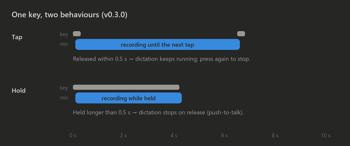
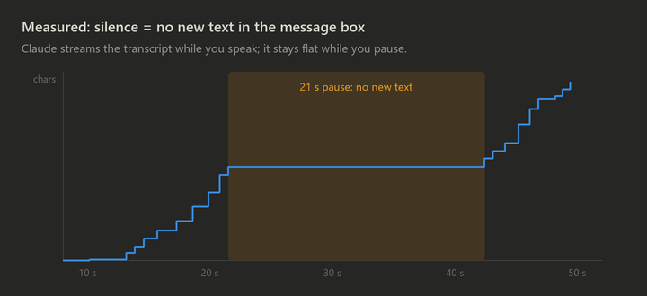
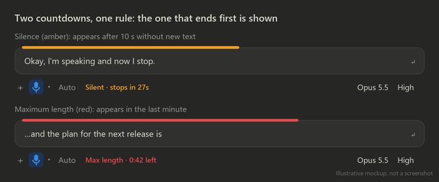
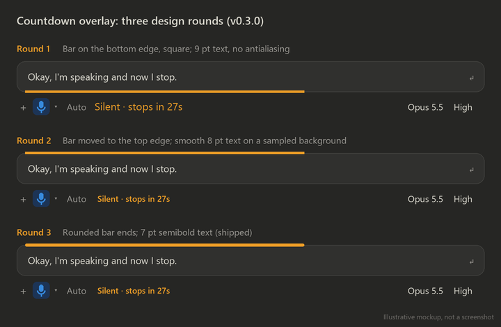
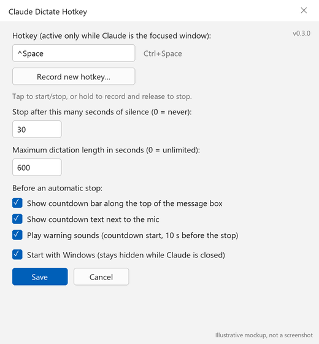
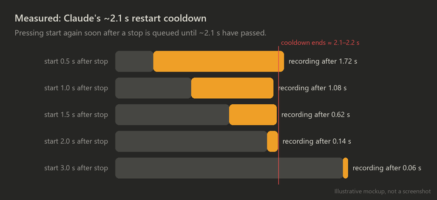
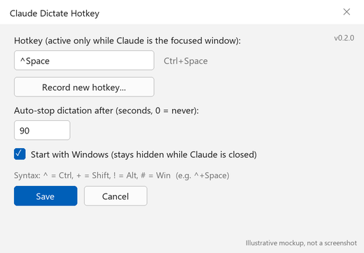
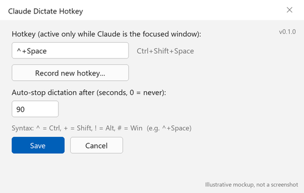

# Changelog

All notable changes to Claude Dictate Hotkey. Images in [`docs/history`](docs/history) are
illustrative mockups and charts of measured data, not screenshots.

## Unreleased

## 0.4.0 (2026-10-14): companion to Claude's dictation shortcut

### Context

- **2026-10-14:** the Claude desktop app (version 2.37337) added its own dictation shortcut on
  Windows, configurable in Settings (default `Ctrl+D`). It works only while Claude is focused,
  targets the pane you're in, offers toggle *or* hold (one at a time), and does not stop on silence.
  The original reason for this tool, "Claude has no dictation shortcut", no longer holds.
- The Dictate button's accessibility shortcut property reports `Shift+F10`, not the configured key,
  so the native shortcut can't be read from outside.

### Changed

- Silence stop, maximum length and the countdown overlay now apply to **any** dictation in the
  active Claude window: started with Claude's own shortcut, the mouse, or this tool's hotkey.
  Recordings are detected within 0.5 s (up to 20 s in a newly opened pane).
- Maximum length counts from when recording actually began.
- The tool's own hotkey is optional: Settings → "Use own hotkey (tap to toggle, hold to talk)".
  Without it, Claude's dictation shortcut starts recording and this tool only adds the silence
  stop, maximum length and countdown. New installs start without a hotkey; a saved hotkey is kept.

### Fixed

- Claude 2.37337 moved the mic button onto the message row and the mode buttons ("Auto") below
  the box. The message box wasn't found any more, so speech was treated as silence and the
  countdown bar and text never appeared. The message box, its outline and the text position are
  now found relative to the mic button, in either layout.
- If the message box can't be found, the silence stop is skipped instead of firing.
- First hotkey press after a pause turned dictation on and immediately off: a slow button lookup
  (~0.7 s) was mistaken for a hold. Tap vs hold now follows whether the key is still held.
- The countdown bar and text could reappear after dictation stopped and stay on screen.
- The countdown stays visible while Claude is visible but not the active window (e.g. you're
  working on another monitor); it hides when Claude is covered or minimized.
- The countdown fades in and out (~0.3 s) instead of popping, including when another window
  covers and uncovers it.

### Docs

- README repositioned as a companion to Claude's own dictation shortcut.

## 0.3.0 (2026-09-29)

### Added

- **Tap or hold on one key:** tap (under 0.5 s) to toggle; hold to record and release to stop.
  
- **Silence auto-stop:** stops after N seconds without new dictated text. Silence is read from the
  transcript Claude streams into the message box, so background noise doesn't count.
  
- **Maximum dictation length** (replaces the plain auto-stop timer).
- **Countdown overlay before automatic stops:** a bar along the top of the message box, countdown
  text next to the mic, a soft tick when a countdown starts and a double click 10 s before the stop.
  Fades out when you speak again. The countdown that ends first is shown.
  
  
- Settings for the silence limit, maximum length, and each overlay part.
  

### Fixed

- Works with Claude's **Hold to record** setting (the button is renamed `Press and hold to record`).
- Reliable stops around Claude's timing: a ~2.1 s restart cooldown after a stop, and stops dropped
  in the first ~0.7 s of a recording. Queued starts show a hint; repeat presses are ignored.
  
- "Element not available" error after releasing: Claude rebuilds the button on every state
  change, so every read and click now looks it up fresh.

### Changed

- Defaults: silence stop 30 s, maximum length 10 minutes.

## 0.2.0 (2026-09-29)

### Added

- **Start with Windows** option; the tray icon shows only while a Claude window is open.
- **Packaging:** compiled exe, per-user installer (no admin rights), portable zip, SHA256 hashes.
  Settings move to `%APPDATA%\ClaudeDictateHotkey\` (portable mode if `settings.ini` sits next
  to the exe).
- README: where it works (desktop Chat and Code tabs; the CLI uses its built-in `/voice`), and
  antivirus/SmartScreen notes.
  

### Changed

- Default hotkey `Ctrl+Space` (was `Ctrl+Shift+Space`).
- Copyright holder: AweDev.

## 0.1.0 (2026-09-29)

### Added

- Hotkey (`Ctrl+Shift+Space`) that toggles the Claude desktop app's Dictate button through
  Windows UI Automation, only while Claude is focused. Split view: targets the focused pane.
- Settings window: type or record a hotkey, auto-stop timer (90 s).
  
