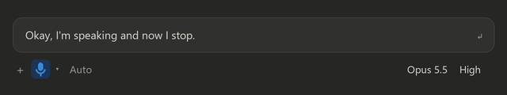

# Claude Dictate Hotkey

<p align="center">
  <a href="https://github.com/AweGuider/Claude-Dictate-Hotkey/actions/workflows/build.yml"></a>
  <a href="https://github.com/AweGuider/Claude-Dictate-Hotkey/releases"></a>
  <a href="LICENSE"></a>
  
</p>

<p align="center">
  <a href="#install">Install</a> ·
  <a href="#usage">Usage</a> ·
  <a href="#where-it-works">Where it works</a> ·
  <a href="#how-it-works">How it works</a> ·
  <a href="#building">Building</a> ·
  <a href="CHANGELOG.md">Changelog</a>
</p>

<p align="center">
  
  <br><sub>Illustrative mockup of the silence countdown.</sub>
</p>

A dictation hotkey for the Claude desktop app on Windows. Press **Ctrl+Space** in Claude: **tap**
to start and tap again to stop, or **hold** to record and release to stop.

Claude has its own dictation shortcut too, but it does tap *or* hold, not both, and never stops on
its own. This tool adds, for any dictation in Claude, however you started it:

- **Silence stop:** dictation stops by itself after 30 seconds without new words.
- **Maximum length:** dictation stops after 10 minutes at most.
- **Countdown before either stop:** a shrinking bar on the message box, a short text next to it,
  and soft warning sounds, so a stop never catches you off guard.

The hotkey, both limits and the countdown can be changed or turned off in [Settings](#usage).
If you'd rather use Claude's own shortcut, untick **Use own hotkey** and keep the rest.

> Unofficial community tool. Not affiliated with or endorsed by Anthropic.

## Requirements

- Windows 10/11 (64-bit)
- Claude desktop app
- Claude UI in English. The tool finds the mic button by its English accessible names (`Dictate` /
  `Press and hold to record` / `Stop dictation`), so other display languages aren't supported yet.
- Claude's dictation shortcut is set in Claude's own Settings (default `Ctrl+D`); it only works while
  Claude is the focused window.

## Install

Download from [Releases](https://github.com/AweGuider/Claude-Dictate-Hotkey/releases):

- **Installer** (`ClaudeDictateHotkey-<version>-setup.exe`): per-user install, no admin rights needed.
  Adds Start Menu entries for the app and its Settings, and optionally starts it with Windows.
- **Portable** (`ClaudeDictateHotkey-<version>-portable.zip`): unzip anywhere and run `ClaudeDictateHotkey.exe`.
- **From source**: install [AutoHotkey v2](https://www.autohotkey.com/) and run `ClaudeDictateHotkey.ahk`.

### Antivirus / SmartScreen warnings

Compiled AutoHotkey programs are often flagged as false positives, and the releases are not code-signed yet.
Some antivirus products (e.g. Avast) may also flag the installer, its temporary `setup.tmp`, and the uninstaller.
Every release lists SHA256 hashes in `SHA256SUMS.txt` so you can verify the download, and the source is in
this repository if you prefer to run the `.ahk` directly. False positives can be reported to
[Microsoft](https://www.microsoft.com/wdsi/filesubmission) and [Avast](https://www.avast.com/false-positive-file-form.php).

## Usage

- Settings: Start Menu → **Claude Dictate Hotkey Settings**, `Settings.bat` (portable/source), or
  double-click / right-click the tray icon → **Settings...**
  - **Use own hotkey** (on by default, `Ctrl+Space`): tap to start and tap again to stop, or hold to record
    and release to stop. Works whether Claude's **Hold to record** setting is on or off. Type a
    hotkey in AutoHotkey syntax (`^` Ctrl, `+` Shift, `!` Alt, `#` Win) or click **Record new
    hotkey...** and press the combo. It only fires while Claude is focused. Pick a key different
    from Claude's dictation shortcut: if they match, this one takes over inside Claude. If you use
    an input method that switches on Ctrl+Space (e.g. Chinese or Japanese), avoid that combo.
  - **Silence stop**: seconds without new dictated text before dictation stops; `0` disables it.
    Silence is detected from the transcript Claude writes into the message box, so background
    noise doesn't keep it running. Applies to any dictation, however it was started.
  - **Maximum dictation length** in seconds; `0` means unlimited.
  - **Before an automatic stop**: a shrinking bar along the top of the message box, countdown text
    next to the mic, a soft tick when the countdown starts and a double click 10 s before the stop.
    The silence countdown appears after 10 s of silence (halfway for limits of 20 s or less) and
    fades out when you speak again; the maximum-length one appears in the last minute. If both
    apply, the one that ends first is shown. It stays visible while Claude is visible on screen,
    even if you're working in another window, and fades out when something covers it. Each part
    can be turned off.
  - **Start with Windows**: adds or removes a shortcut in your Startup folder.
  - Applied immediately and saved to `%APPDATA%\ClaudeDictateHotkey\settings.ini`. If a `settings.ini`
    exists next to the program, that one is used instead (portable mode).
- The tray icon is shown only while a Claude window is open. With Claude closed, the script idles in the
  background and reappears when Claude opens, however Claude is launched.

## Where it works

| Surface | Dictation shortcut |
| :- | :- |
| Claude desktop app, **Code** tab | Claude's shortcut or this tool's hotkey; silence stop and countdown from this tool |
| Claude desktop app, **Chat** tab | Same (same Dictate button) |
| Claude Code **CLI** in a terminal | Built in: run `/voice`, then hold `Space` (or `/voice tap` to toggle). Rebind via `voice:pushToTalk` in `~/.claude/keybindings.json`. See the [voice dictation docs](https://code.claude.com/docs/en/voice-dictation). |
| Claude Code **VS Code extension** | Built in (same docs page) |

This tool's hotkey does nothing in terminals. For the CLI, use its built-in `/voice` and pick a key your
terminal doesn't intercept: Windows Terminal, for example, uses `Ctrl+Shift+Space` for its new-tab menu.

## How it works

`ClaudeUia.ahk` uses Windows UI Automation to read Claude's Dictate button. While Claude is the
active window, the tool checks every half second whether any composer is recording (split view
included). When one is, it watches the message box: Claude writes the transcript there as you
speak, so no new text means silence. The hotkey toggles the button through accessibility actions.
No clicks at screen coordinates and nothing inside Claude is modified.

If an app update renames the button, the hotkey beeps and shows "Dictate button not found";
update `DICTATE_IDLE_NAME` / `DICTATE_HOLD_IDLE_NAME` / `DICTATE_ACTIVE_NAME` in `ClaudeUia.ahk`.
If an update moves the button or message box, the silence stop turns itself off rather than
stopping you mid-sentence.

## Building

Requires [Ahk2Exe](https://github.com/AutoHotkey/Ahk2Exe/releases) and [Inno Setup](https://jrsoftware.org/isdl.php).

```powershell
.\build.ps1 -Ahk2Exe <path>\Ahk2Exe.exe
```

Outputs the exe, portable zip, installer and `SHA256SUMS.txt` to `dist\`. The version comes from the
`;@Ahk2Exe-SetVersion` line in `ClaudeDictateHotkey.ahk`. Ahk2Exe defaults to
`C:\Program Files\AutoHotkey\Compiler\Ahk2Exe.exe` (or `$env:AHK2EXE`); pass `-SkipInstaller` to skip Inno Setup.

GitHub Actions builds the same downloads on every push to `main` and `dev` (the **Build** workflow;
files under the run's artifacts). Pushing a version tag such as `v0.4.1` builds them and attaches
them to a pre-release, with notes taken from that version's section in `CHANGELOG.md`. The tag
must match the `;@Ahk2Exe-SetVersion` line.

## Changelog

See [CHANGELOG.md](CHANGELOG.md) for version history, with illustrations.

## License

[MIT](LICENSE). The compiled exe contains the AutoHotkey interpreter (GPLv2), and the installer is
built with Inno Setup; see [THIRD-PARTY-NOTICES.md](THIRD-PARTY-NOTICES.md).
